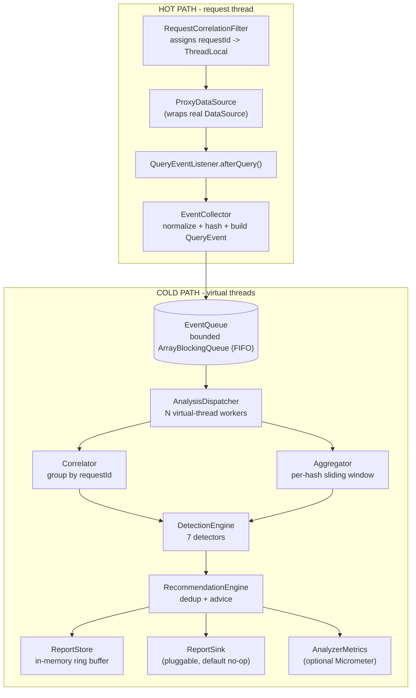

# SQL Analyzer

A reusable **Spring Boot 3.5 / Java 21 auto-configuration library** that detects inefficient
SQL access patterns (N+1, repeated queries, missing pagination, `SELECT *`, long-running queries,
bulk-instead-of-batch writes, oversized transactions) **at runtime**, with near-zero overhead on
the request path.

It is the reference implementation of the method described in the research project
*"Откриване на неефективни SQL заявки към релационни бази данни в микро-услуги"* (section 4,
"Detection Methodology").

A consumer adds the dependency and the analyzer transparently wraps the application `DataSource`.
**No business code changes are required.**

---

## Table of contents

- [The one-sentence version](#the-one-sentence-version)
- [Phase 1: Startup wiring](#phase-1-startup-wiring-what-gets-created)
- [Phase 2: Runtime flow](#phase-2-runtime-flow-what-happens-per-request)
- [Architecture diagram](#architecture-diagram)
- [Most important classes](#most-important-classes)
- [FAQ / deep dive](#faq--deep-dive) (answers your specific questions)
- [Configuration reference](#configuration-reference)
- [Running the demo](#running-the-demo)
- [Known limitations](#known-limitations)

---

## The one-sentence version

A `BeanPostProcessor` secretly wraps your `DataSource`, so every SQL execution notifies a listener
that drops a cheap event into a bounded in-memory queue; background **virtual threads** drain that
queue, group events by HTTP request, run detector rules, and turn hits into recommendations — all
**off the request thread**.

The guiding principle (from Dean & Barroso, *The Tail at Scale*) is that instrumentation overhead
must **never become correlated with the request critical path**. Everything in the design follows
from that one rule.

---

## Phase 1: Startup wiring (what gets created)

The library is discovered purely through Spring Boot auto-configuration — no `@Import`, no consumer
code. Boot reads:

```
src/main/resources/META-INF/spring/org.springframework.boot.autoconfigure.AutoConfiguration.imports
```

which activates three configuration classes:

| Class | Condition | Creates |
|---|---|---|
| `SqlAnalyzerMetricsConfiguration` | Micrometer on classpath | `AnalyzerMetrics` (Micrometer-backed if a `MeterRegistry` bean exists, otherwise no-op) |
| `SqlAnalyzerAutoConfiguration` | `sqlanalyzer.enabled=true` (default) | The whole pipeline: `SqlNormalizer`, `EventQueue`, `EventCollector`, `QueryEventListener`, `Aggregator`, the 7 detectors, `ReportStore`, default no-op `ReportSink`, `RecommendationEngine`, `DetectionEngine`, `Correlator`, `AnalysisDispatcher`, and the `DataSourceProxyBeanPostProcessor` |
| `SqlAnalyzerWebAutoConfiguration` | Servlet web app | `RequestCorrelationFilter` (highest precedence) and `ReportController` |

Two wiring details matter most:

**1. The DataSource hijack.** `DataSourceProxyBeanPostProcessor` is registered as a `static @Bean`
(static so it participates very early in the bean lifecycle). As Spring creates every *other* bean,
this processor inspects each one; when it sees a `DataSource` (e.g. your `HikariDataSource`), it
returns a `datasource-proxy` wrapper instead of the original. Hibernate/JPA/JOOQ/raw JDBC all ask
Spring for "the DataSource" and unknowingly receive the proxy. This is *why* integration needs zero
code. The listener is resolved lazily (through a `Supplier`) so that registering the processor does
not force the analyzer beans to initialize prematurely.

**2. The background engine boot.** `AnalysisDispatcher implements SmartLifecycle`. When the context
is fully ready, Spring calls its `start()`, which launches the virtual-thread workers and a periodic
aggregate scheduler. You can see this at startup: `AnalysisDispatcher started [workers=2]`.

---

## Phase 2: Runtime flow (what happens per request)

A single HTTP request crosses two threading worlds — the **hot path** (request thread) and the
**cold path** (virtual threads):

1. **Correlation starts.** `RequestCorrelationFilter.doFilterInternal` runs first (registered at
   `HIGHEST_PRECEDENCE`). It generates a `requestId` (UUID) and stores it in `RequestContext` — a
   `ThreadLocal` — and in the SLF4J MDC for logging.
2. **Your code runs normally.** Controller → `@Transactional` service → repository → Hibernate →
   JDBC → the **wrapped** `ProxyDataSource`.
3. **Interception fires.** For each statement, `datasource-proxy` calls
   `QueryEventListener.afterQuery(...)` **on the request thread**. The listener extracts duration
   (ms → ns), row count (from the JDBC result / update count), and a transaction id (the JDBC
   connection id), then calls the collector for every query in the batch.
4. **Lightweight capture.** `EventCollector.collect(...)` does the only "thinking" on the hot path,
   and it is deliberately cheap: normalize the SQL (`SqlNormalizer`: literals → `?`, IN-lists
   collapsed, whitespace squashed, lowercased), hash it (SHA-256, truncated), detect the query type,
   read the `requestId` from the `ThreadLocal`, optionally capture a stack hint, and assemble an
   immutable `QueryEvent` record.
5. **Handoff and bail.** The event is `offer`ed onto `EventQueue`. The request thread's involvement
   ends here — this is the hot/cold boundary.
6. **Request-end marker.** When the response completes, the filter's `finally` block calls
   `eventQueue.offerRequestEnd(requestId)` and clears the `ThreadLocal`/MDC. That marker is how the
   cold side learns a request's query window is complete.
7. **Cold path drains.** `AnalysisDispatcher`'s virtual-thread workers loop on `eventQueue.poll(...)`.
   - A `Query` item → `Correlator.onEvent()` (bucket by requestId) **and** `Aggregator.record()`
     (per-hash sliding-window latency samples).
   - A `RequestEnd` item → `Correlator.onRequestEnd()` removes that request's list and hands the
     **full ordered sequence** to the `DetectionEngine`.
8. **Detection runs.** `DetectionEngine.analyzeRequest()` runs every request-scoped detector. A
   separate scheduled pass (every 30s) runs `analyzeAggregate()` for the `LongRunningQueryDetector`.
9. **Recommendation + storage.** Each `Detection` goes to `RecommendationEngine.handle()`: dedup
   (same finding within 60s suppressed) → map `DetectionType` to advice → build a `Recommendation` →
   write to `ReportStore`, the `ReportSink`, and the metrics counter.
10. **Read-out.** `ReportController` exposes the store at `/api/v1/sqlanalyzer/reports` and `/summary`.

---

## Architecture diagram



---

## Most important classes

If you internalize these, you understand the library:

1. **`DataSourceProxyBeanPostProcessor`** — the magic; wraps the `DataSource`. Without it, nothing is observed.
2. **`QueryEventListener`** — the interception callback; the bridge from `datasource-proxy` into the library.
3. **`EventCollector` + `SqlNormalizer`** — hot-path capture, plus the normalization/hashing that makes "the same query shape" groupable.
4. **`EventQueue`** — the hot/cold boundary and safety valve (drop-newest backpressure).
5. **`AnalysisDispatcher`** — the cold-path engine; owns the virtual threads and the periodic aggregate pass.
6. **`Correlator`** — groups events by `requestId`; this is what makes N+1 detectable at all.
7. **`Detector` implementations** (`analyzer/detection/impl/`) — the actual rules; small, independent, threshold-driven.
8. **`RecommendationEngine` + `ReportStore`** — turn raw detections into deduplicated, retrievable advice.
9. **`SqlAnalyzerAutoConfiguration`** — wiring that assembles all of the above.

---

## FAQ / deep dive

### What happens to the event queue?

`EventQueue` wraps a single **bounded `java.util.concurrent.ArrayBlockingQueue<QueueItem>`** held in
JVM heap. The request thread is the **producer** (`offerEvent` / `offerRequestEnd`); the
`AnalysisDispatcher` workers are the **consumers** (`poll`). Items are one of two kinds (a sealed
`QueueItem`): `QueueItem.Query` (a captured `QueryEvent`) or `QueueItem.RequestEnd` (a marker that a
request finished). Once a worker polls an item, it is removed from the queue and routed to the
correlator/aggregator. The queue itself stores nothing permanently — it is a transient handoff buffer.

### Are the analytics exported somewhere or persisted in a database?

**Not by default.** Out of the box there is **no database persistence**. Detections and
recommendations live only in the in-memory `ReportStore`. There are, however, three optional
export/observation channels:

1. **`ReportSink`** — a pluggable interface called for every recommendation. The default
   implementation is a no-op. This is the extension point for real persistence (see next question).
2. **`AnalyzerMetrics`** — if Micrometer is present, per-type detection counters plus queue
   depth/dropped gauges are published, so they can be scraped by Prometheus and shown in Grafana.
3. **`ReportController`** — read-only HTTP endpoints (`/api/v1/sqlanalyzer/reports`, `/summary`)
   for ad-hoc inspection.

### How do reports and recommendations get stored, and where?

The default store is `ReportStore`: a **bounded in-memory ring buffer** (`ArrayDeque`, default
capacity 500, configurable via `sqlanalyzer.report.capacity`) plus per-type counts. When it exceeds
capacity, the oldest recommendation is dropped. It is **process-local and volatile** — restarting the
app clears it.

`RecommendationEngine.handle()` is the single write point. For each detection it:
- suppresses near-duplicate findings within a 60-second window,
- maps the `DetectionType` to human advice (description + suggested fix),
- writes the resulting `Recommendation` to `ReportStore`, to the `ReportSink`, and to metrics.

### In a real system there must be some storage — how would I add it?

Yes. For anything beyond local debugging you provide your own `ReportSink` bean and the library uses
it automatically (it backs off its default no-op via `@ConditionalOnMissingBean`). Example: persist
to a table.

```java
@Component
class JdbcReportSink implements ReportSink {

    private final JdbcTemplate jdbc;

    JdbcReportSink(JdbcTemplate jdbc) {
        this.jdbc = jdbc;
    }

    @Override
    public void export(Recommendation r) {
        jdbc.update(
            "INSERT INTO sql_recommendation (type, severity, request_id, description, action, created_at) " +
            "VALUES (?, ?, ?, ?, ?, ?)",
            r.type().name(), r.severity().name(), r.requestId(),
            r.description(), r.suggestedAction(), Timestamp.from(r.createdAt()));
    }
}
```

Other realistic sinks: append JSON lines for a CI/CD gate (fail the build on a HIGH-severity
detection), publish to Kafka, or push to a log aggregator. The point of the `ReportSink` seam is that
the **library stays storage-agnostic** — it never forces JPA or a DB on a consumer.

### One HTTP request triggers multiple SQL executions — how do I know two SQLs belong to the same request / transaction?

Two independent correlation keys are attached to **every** `QueryEvent`:

- **`requestId`** — the HTTP correlation. `RequestCorrelationFilter` mints a UUID per request and
  stores it in a `ThreadLocal` (`RequestContext`). Because JDBC executes on the same request thread,
  `EventCollector` reads that `ThreadLocal` and stamps it onto each event. **Crucially, the id is
  *copied into the event* before the event crosses into the queue** — `ThreadLocal`s do not follow
  data onto worker threads, so copying is mandatory. On the cold side, `Correlator` buckets events
  into a `ConcurrentHashMap<requestId, List<QueryEvent>>`. When the matching `RequestEnd` marker
  arrives, that list *is* "all SQLs for that one request," in order. That is exactly what the N+1
  and repeated-query detectors consume.

- **`transactionId`** — the database-connection correlation. It is derived from the
  `datasource-proxy` **connection id** (`execInfo.getConnectionId()`). Statements sharing a
  connection (and thus, within a `@Transactional` boundary, a transaction) share this id. The
  `TransactionSpanAnomalyDetector` groups by it to spot oversized transactions.

  > Honest caveat: this is a **connection** identifier, not a true database transaction id. Within a
  > standard request-scoped transaction the two line up, but with connection pooling reuse or manual
  > connection juggling it is an approximation. See *Known limitations*.

### What is the component that checks the queue?

`AnalysisDispatcher`. On `start()` it submits `workerCount` (default 2, see
`sqlanalyzer.queue.workers`) identical `drainLoop()` tasks to a virtual-thread executor. Each loop
calls `eventQueue.poll(200ms, MILLISECONDS)` and, for any item returned, calls `dispatch(...)` which
fans `Query` items into the `Correlator` + `Aggregator` and routes `RequestEnd` items to
`Correlator.onRequestEnd()`. A separate single daemon thread runs the periodic aggregate detection
pass every 30 seconds. Exceptions in a worker are caught and logged so one bad item never kills the
loop.

### What happens when the queue is full?

It applies a **drop-newest** policy. `EventQueue.offerEvent`/`offerRequestEnd` use the non-blocking
`ArrayBlockingQueue.offer(...)`; if the queue is at capacity, `offer` returns `false`, the event is
**discarded**, and an `AtomicLong droppedCount` is incremented (exposed as a Micrometer gauge,
`sqlanalyzer.queue.dropped`). The request thread is **never blocked** — under load the analyzer
sacrifices completeness to protect application latency. This is the concrete implementation of
"graceful degradation" / "overhead must not correlate with the critical path."

### Is this a priority queue? Is it in memory only?

No, it is **not** a priority queue — it is a plain **FIFO `ArrayBlockingQueue`**; all events are
equal and processed in arrival order. And yes, it is **in-memory only** (JVM heap, single process).
There is no disk spillover, no broker, no cross-process durability. If the process dies, in-flight
events and the in-memory reports are gone. (Durable, cross-instance analysis is explicitly out of
scope per the research method — this is a single-instance, application-side tool.)

### Where do the virtual threads come from? Where do they live?

They are **Java 21 virtual threads**, created in `AnalysisDispatcher.start()` via
`Executors.newVirtualThreadPerTaskExecutor()`. They live **inside the application's JVM process**,
managed by that executor; the dispatcher holds the only reference. Virtual threads are **not** OS
threads — the JVM multiplexes (mounts/unmounts) many of them onto a small pool of carrier *platform*
threads (the default `ForkJoinPool`). When a worker blocks in `poll(...)` waiting for events, its
virtual thread is cheaply unmounted, so idle workers cost almost nothing. They are shut down in
`AnalysisDispatcher.stop()` (a `SmartLifecycle` callback) when the Spring context closes. The
periodic aggregate scheduler uses one separate **daemon platform thread** named `sqlanalyzer-aggregate`.

---

## Configuration reference

All properties are optional and have sensible defaults. Prefix: `sqlanalyzer`.

| Property | Default | Meaning |
|---|---|---|
| `sqlanalyzer.enabled` | `true` | Master switch for the whole library |
| `sqlanalyzer.capture-raw-sql` | `true` | Keep the raw (un-normalized) SQL on each event (high cardinality) |
| `sqlanalyzer.capture-stack-hint` | `false` | Capture a short stack hint to locate the originating app class |
| `sqlanalyzer.queue.capacity` | `10000` | Max buffered events before drop-newest kicks in |
| `sqlanalyzer.queue.workers` | `2` | Number of virtual-thread analysis workers |
| `sqlanalyzer.detectors.n-plus-one-threshold` | `3` | Identical PK lookups within one request to flag N+1 |
| `sqlanalyzer.detectors.repeated-query-threshold` | `2` | Identical query repeats within one request |
| `sqlanalyzer.detectors.missing-pagination-row-count` | `1000` | Returned rows for an unbounded SELECT |
| `sqlanalyzer.detectors.long-running-millis` | `500` | p95 latency threshold (ms) |
| `sqlanalyzer.detectors.bulk-threshold` | `10` | Identical INSERT/UPDATE within one request |
| `sqlanalyzer.detectors.transaction-span-threshold` | `50` | Statements within one transaction |
| `sqlanalyzer.report.capacity` | `500` | Max recommendations kept in the in-memory store |
| `sqlanalyzer.report.endpoint-enabled` | `true` | Expose the read-only report controller (web apps only) |

Thresholds are per-application because, as the method notes, *what is an anomaly in one service may
be normal in another*.

---

## Running the demo

The demo (a catalog/orders app deliberately seeded with anti-patterns) lives under `src/test` and is
**not** shipped with the library. It boots a throwaway PostgreSQL via Testcontainers, so Docker /
Colima must be running.

```bash
cd sqlanalyzer
./gradlew bootTestRun        # starts on http://localhost:8080
```

> `./gradlew bootRun` will NOT work — this is a library, so there is no `main` class in `src/main`.
> `bootTestRun` is pinned (in `build.gradle`) to `TestSqlanalyzerApplication`, which boots
> `DemoApplication` + Testcontainers PostgreSQL.

In a second terminal, trigger the anti-patterns and read the findings:

```bash
# generate inefficient access patterns
curl localhost:8080/api/demo/orders
curl localhost:8080/api/demo/products
curl localhost:8080/api/demo/products/raw
curl localhost:8080/api/demo/orders/1/repeated
curl -X POST "localhost:8080/api/demo/import?count=60"

# read what the analyzer detected + its recommendations (wait ~1s; analysis is async)
curl localhost:8080/api/v1/sqlanalyzer/reports
curl localhost:8080/api/v1/sqlanalyzer/summary

# optional: Micrometer metrics
curl localhost:8080/actuator/prometheus | grep sqlanalyzer
```

Detection is asynchronous and request-scoped detectors fire only when a request **finishes**, so
allow a moment after the calls before reading `/reports`.

To verify the library build and run the test suite:

```bash
./gradlew build        # compiles the library jar + runs unit + integration tests (needs Docker)
```

---

## Known limitations

These follow the research method's stated scope (section 4.7), plus a couple of implementation notes:

- **In-memory, single-instance, volatile.** No persistence and no cross-service/cross-instance
  correlation by default. Add a `ReportSink` for durability.
- **`transactionId` is a connection id**, not a true DB transaction id — an approximation under
  connection-pool reuse.
- **Row count is best-effort.** `datasource-proxy` exposes affected-row counts for writes but not
  consumed rows for `SELECT`s, so `MissingPaginationDetector` mostly fires on structural unbounded
  scans (no `WHERE`/`LIMIT`) rather than a strict `rowCount >= N`.
- **Drop-newest can drop a `RequestEnd` marker.** Under sustained overflow, if a request's end
  marker is dropped, that request's bucket in the `Correlator` is never closed/analyzed and lingers
  in the map. A bounded TTL/eviction on `Correlator` active requests is a sensible future hardening.
- **Textual (not AST) normalization.** Two semantically equal queries with different text may hash
  differently. An AST-based normalizer would be more precise but heavier.
- **PostgreSQL is the primary target.** Other dialects need normalization/pagination rules checked
  (e.g. `TOP` in SQL Server).
```
